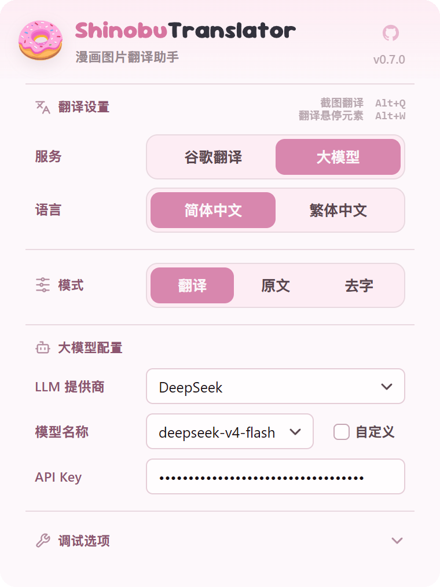
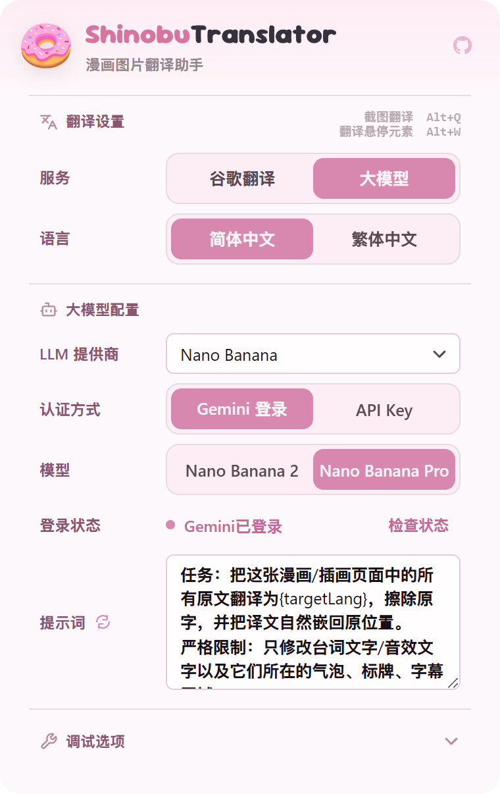

<p align="center">


</p>

<h1 align="center">dmbTranslator</h1>

<p align="center">

在浏览器里直接翻译漫画图片的 Chromium / Firefox 扩展。

</p>

<p align="center">

<a href="LICENSE"></a>

<a href="https://github.com/DonutShinobu/ShinobuTranslator"></a>

<a href="https://github.com/kha-white/manga-ocr"></a>

<a href="https://github.com/zyddnys/manga-image-translator"></a>

</p>

一款漫画翻译扩展：识别图片中的日文文本框，交给大模型翻译，擦除原文后重新排版嵌字，以覆盖层贴回原图位置。主要面向日文漫画场景，对 X / Pixiv / e-hentai 做了专门适配，其他网站可用右键或快捷键截图翻译。

> **本文件是 `frontend/`（浏览器扩展目录）的说明。整个项目的说明见 [仓库根 README](../README.md)。**

一款漫画翻译扩展：识别图片中的日文文本框，交给大模型翻译，擦除原文后重新排版嵌字，以覆盖层贴回原图位置。主要面向日文漫画场景，对 X / Pixiv / e-hentai 做了专门适配，其他网站可用右键或快捷键截图翻译。

本目录是 [ShinobuTranslator](https://github.com/DonutShinobu/ShinobuTranslator) 的代码（`@ a5af759` / v0.8.3），被本项目复用为主管线；本项目的改动登记见 [`docs/UPSTREAM.md`](../docs/UPSTREAM.md)。

> **安装前请先读这一段。**
>
> 整个仓库有两部分：**浏览器扩展**（`frontend/`，也就是本目录）和**本机 Python 服务**（仓库根的 `server/`）。
>
> 本地翻译路线依赖后者跑在 `127.0.0.1:11436`，它需要单独的 Python 依赖（torch 等），
>
> **不在 `npm install` 的范围内**，安装见 [仓库根 README](../README.md#从源码运行)。
>
> - 想立刻能用：走 **Nano Banana（Gemini 整图翻译）** 路线，不需要任何本机服务。
> - 想用本地流水线：需自行准备 OCR 服务，接口契约见 [本机 OCR 服务](#本机-ocr-服务)。

---

## 快速开始

### 手动安装

1. 前往 [Releases](../../releases) 下载对应浏览器的压缩包：Chromium 使用 `dmbTranslator-chromium-v*.zip`，Firefox 使用 `dmbTranslator-firefox-v*.zip`
2. 解压到本地文件夹
3. Chrome / Edge：打开扩展管理页，启用「开发者模式」，选择「加载已解压的扩展程序」
4. Firefox Desktop 140+：打开 `about:debugging#/runtime/this-firefox`，选择「临时载入附加组件」，再选择解压目录中的 `manifest.json`

本分叉没有上架商店，只能手动加载或从 Release 的 zip 解压。若要从源码构建，见 [从源码运行](#从源码运行)。

> **OCR 翻译依赖一个本机 Python 服务**（不是云端）。装完扩展还要按
>
> [本机 OCR 服务](#本机-ocr-服务) 起服务，并按
>
> [注册 Native Messaging 宿主](#注册-native-messaging-宿主让扩展能起停服务)
>
> 让扩展里的「启动 / 停止服务」按钮可用。

---

## 效果展示

<table>

<thead>

<tr>

<th align="center" width="50%">原始图片</th>

<th align="center" width="50%">翻译后图片</th>

</tr>

</thead>

<tbody>

<tr>

<td align="center" width="50%">

  <a href="https://user-images.githubusercontent.com/31543482/232265329-6a560438-e887-4f7f-b6a1-a61b8648f781.png">

```

```

  </a>

<a href="https://twitter.com/09ra_19ra/status/1647079591109103617/photo/1">Source @09ra_19ra</a>

</td>

<td align="center" width="50%">

  <a href="assets/readme/translated1.png">

```

```

  </a>

</td>

</tr>

<tr>

<td align="center" width="50%">

  <a href="https://user-images.githubusercontent.com/31543482/232265794-5ea8a0cb-42fe-4438-80b7-3bf7eaf0ff2c.png">

```

```

  </a>

<a href="https://twitter.com/rikak/status/1642727617886556160/photo/1">Source @rikak</a>

</td>

<td align="center" width="50%">

  <a href="assets/readme/translated4.png">

```

```

  </a>

</td>

</tr>

</tbody>

</table>

---

## 工作流程

### 本地流水线（需 OCR 服务）

```text
图片获取 → 文本检测 → 气泡检测 → OCR 识别 → 文本翻译 → 蒙版细化 → 去字修复 → 自动排版 → 译图展示
```

检测、气泡、去字、排版在浏览器端用 ONNX 模型完成；**OCR 与翻译由本机服务或云端大模型承担**。

### Nano Banana 图像翻译（无需本机服务）

```text
图片获取 → 发送图片与提示词 → 多模态理解和翻译 → 去字重绘和嵌字 → 译图展示
```

不走本地 OCR、去字和自动排版链路，把整张图交给 Gemini 端到端翻译。对拟声词和手写字体的效果更佳，也能处理英文、韩文等语言，但会对画面本身有一定影响。

LLM 提供商设为 `gemini` 时自动走整图路线，其他提供商走本地流水线。

---

## 功能特性

| 模块          | 说明                                                     |
| ----------- | ------------------------------------------------------ |
| 文本检测        | 自动识别漫画图中的文字区域                                          |
| 气泡检测        | 辅助定位对白区域，让去字和嵌字更自然                                     |
| OCR 识别      | 由本机服务的 manga-ocr 识别日文                                  |
| 翻译          | 支持 DeepSeek、GLM、Kimi、MiniMax、MiMo、OpenAI、Gemini、自定义提供商 |
| Nano Banana | 使用 Gemini 做端到端图像翻译与嵌字                                  |
| 去字修复        | 擦除原文文字                                                 |
| 自动排版        | 根据文字区域、方向、颜色和气泡空间自动嵌入译文                                |
| 原图切换        | 支持原图和译图切换查看                                            |
| 向后预取        | 看第 N 页时后台预译后续页，默认 4 页（0–10 可调，0 = 关闭）                  |
| 进入自动翻译      | 到达阅读页即译当前页，默认关闭                                        |
| 译图缓存        | 内存 LRU，默认 200 条；仅内存，刷新页面即失效                            |
| 诊断日志        | 存扩展本地，可从弹窗下载；默认关闭                                      |

### 站点与阅读器适配

- **站点**：X（Twitter）、Pixiv、e-hentai
- **阅读器引擎**：Comici、GigaViewer、BINB、Clip Studio Reader、PUBLUS
- 未匹配的站点退化为通用模式，仍可用截图翻译

---

## 设置界面

<table>

<tr>

<td align="center" width="50%">



文本翻译设置

</td>

<td align="center" width="50%">



Nano Banana 图像翻译设置

</td>

</tr>

</table>

---

## 使用方式

### 已适配站点

在 X、Pixiv、e-hentai 的已适配页面中，大图页面会直接显示翻译按钮。

### 通用网页翻译

| 操作     | 默认快捷键   | 说明             |
| ------ | ------- | -------------- |
| 右键翻译图片 | -       | 对右键位置的图片发起翻译   |
| 截图翻译   | `Alt+Q` | 手动框选页面区域并翻译    |
| 翻译悬停元素 | `Alt+W` | 翻译鼠标当前悬停的图片或区域 |

快捷键可在浏览器的扩展快捷键页面中调整。

---

## 翻译配置

扩展弹出页提供以下常用配置，改完立即生效，不需要重启扩展：

| 配置        | 默认值    | 说明                                                  |
| --------- | ------ | --------------------------------------------------- |
| 模型来源      | 在线模型   | 「本地模型」= 自定义提供商 + 指向本机 11436                         |
| 大模型提供商    | -      | DeepSeek、GLM、Kimi、MiniMax、MiMo、OpenAI、Gemini、自定义提供商 |
| API Key   | 空      | 由用户在扩展设置中输入，仓库不包含任何密钥                               |
| 目标语言      | 简体中文   | 另有繁体中文                                              |
| 向后预载      | 4      | 0 = 关闭预取                                            |
| 进入自动翻译    | 关闭     | 到达阅读页即译当前页                                          |
| 译图缓存条数    | 200    | 仅内存，刷新失效                                            |
| 事件日志      | 开启     | 写本机服务 `logs/events`                                 |
| 诊断日志      | 关闭     | 存扩展本地；勾选后出现「下载日志」按钮                                 |
| 记录原文 / 译文 | **关闭** | 隐私项；须先开「诊断日志」才可勾选                                   |

「记录原文 / 译文」默认关闭，意味着日志里**不会出现**漫画原文与译文。只有打开它，逐行日文原文和中文译文才会写进日志。导出支持包前请留意此开关。

---

## 本机 OCR 服务

本地流水线依赖一个跑在 `127.0.0.1:11436` 的 Python 服务，代码在 [`../server`](../server)，

启动脚本在 [`../scripts`](../scripts)。若你要接自己的实现，满足下面这个契约即可：

```
POST /ocr
请求：{"images":[{"id":"region-0","data":"data:image/png;base64,...","direction":"horizontal"}]}
响应：[{"id":"region-0","text":"识别出的日文","confidence":0.95}]     // JSON 数组
可选响应头：X-DMB-Timing（服务端自报耗时，会被写进日志）
```

- 请求方会带 `X-DMB-Request-Id` 请求头，服务端沿用并回显，用于两侧日志对齐
- 另有 `POST /log/events` 接收扩展侧批量事件，`GET /support` 导出支持包
- 服务不可达时 OCR 会直接报错，不会静默返回空结果

**服务端要求**：Python 3.11，依赖 `torch`、`transformers`、`Pillow`、`jaconv`、`loguru`；

manga-ocr 权重首次启动会从 HuggingFace 拉取。端口 **11436**（OCR + 翻译）、**11437**（Ollama 控制）、

**11434**（Ollama 引擎）。

启动（需先 `set DMB_PYTHON=<带 torch/PIL 的 python.exe>`，否则脚本会依次尝试

`../.venv`、`py`、`python`）：

```bat
cd ..
scripts\start_server.cmd       :: 11436
scripts\start_ollama.cmd       :: 11437（仅本地模型需要）
```

启动脚本只有 Windows 版本，Linux / macOS 未验证。

### 注册 Native Messaging 宿主（让扩展能起停服务）

用上面的 `.cmd` 手动起服务就已经能翻译了。想让**扩展里的「启动 / 停止服务」按钮**直接控制本机进程

（不用每次开终端），还要注册一个 Native Messaging 宿主 —— 这是 Chrome 与本机进程通信的唯一通道。

```bat
pip install pyinstaller
python local\scripts\install_native_host.py <扩展ID>
```

`<扩展ID>` 在 `chrome://extensions` 的扩展卡片上就有，是 **32 个 a–p 的小写字母**。

脚本全程在用户级操作、**不需要管理员**，做四件事：

1. 用 PyInstaller 把 `../server/nm_launcher.py` 编成无窗口 exe（`run/nm_host_launcher.exe`）
2. 写 `run/nm_launcher.json` —— exe 靠它找到 Python 解释器和 `native_host.py`
3. 生成宿主清单 `run/native_host_manifest.json`，`path` 指向 exe（指向 exe 而非 `.cmd`，

   否则每次通信会闪一个终端窗口）
4. 写注册表 `HKCU\Software\Google\Chrome\NativeMessagingHosts\com.dmb.translator`

`run/` 整个目录在 `.gitignore` 里（里面有 8 MB 的 exe 和本机绝对路径），**不要提交**。

卸载：

```bat
python local\scripts\install_native_host.py --remove
```

三个注意点：

- **扩展 ID 变了要重跑这个脚本**。扩展目录位置或 manifest key 变了 ID 就会变，ID 不对宿主不响应
- `pip install pyinstaller` 要装在**运行这个脚本的那个 Python** 里（脚本优先用它自己所在的解释器）。

  想另外指定，设 `DMB_PYINSTALLER_PYTHON=<装了 pyinstaller 的 python.exe>`
- 只支持 Windows（依赖注册表），Linux / macOS 未实现

### 服务端环境变量

这些是模块级常量，**改完必须重启对应服务**。

| 变量                      | 默认                                | 作用                                     |
| ----------------------- | --------------------------------- | -------------------------------------- |
| `DMB_PYTHON`            | -                                 | 启动脚本使用的解释器                             |
| `DMB_MANGA_OCR_MODEL`   | `<project>/models/manga-ocr-base` | 本地 manga-ocr 权重目录                      |
| `DMB_HF_MIRROR`         | `1`                               | 走 `hf-mirror.com`；设 `0` 直连 HuggingFace |
| `DMB_KEEP_ALIVE`        | `15m`                             | Ollama 空闲多久自动卸载；`-1` = 永不过期            |
| `DMB_EVENT_LOG`         | `1`                               | 事件流总开关                                 |
| `DMB_EVENT_LOG_VERBOSE` | `0`                               | 服务端是否写含原文的详细层                          |
| `DMB_DEBUG`             | `0`                               | 调试转储                                   |

---

## 本地模型与运行时

扩展使用 `onnxruntime-web` 在浏览器端运行视觉模型，运行时会按环境尝试 WebGPU、WebNN 或 WASM。

模型由 `npm run models:download` 拉取，约 **206 MB**（`*.onnx` 被 `.gitignore` 排除，克隆后没有模型）：

| 模型                         | 大小    | 用途        |
| -------------------------- | ----- | --------- |
| `detector.ort`             | 94 MB | 文本检测      |
| `aot_inpaint_512.onnx`     | 22 MB | 去字修复      |
| `bubble.onnx`              | 11 MB | 气泡检测      |
| `PP-OCRv6_medium_rec.onnx` | 76 MB | 当前配置下不会加载 |
| `paddleocr_v6_dict.txt`    | 74 KB | 同上        |

默认从上游 release 拉取并校验 sha256。若该来源不可达，需自行把模型放到 `public/models/`，

并保证 sha256 与 `packages/model-manifest/manifest.json` 一致。

> 其中 `bubble.onnx` 与 `aot_inpaint_512.onnx` 的许可证状态未决：本地自用没问题，
>
> 但**不得随仓库或 Release 再分发**。`npm run models:download` 会打印警告；
>
> 发布前可用 `node scripts/download-models.mjs --strict-license` 做严格检查。
>
> 详见 [THIRD\_PARTY\_NOTICES.md](THIRD_PARTY_NOTICES.md)。


## 故障排查

**OCR 报「OCR 服务不可达」**

```bash
curl http://127.0.0.1:11436/health
```

返回 `{"status":"ok","ocr_loaded":true}` 才算就绪。首次启动加载 manga-ocr 约需 30 秒，

此时 `ocr_loaded` 为 `false`，请求会失败。

**翻译慢 / 第一次特别慢**

首次 OCR 加载约 30 秒，之后常驻。本地 LLM 被自动卸载后再次请求会触发冷加载，约 3–6 秒；

空闲 15 分钟自动卸载属预期行为，无需手动重新加载。

**页面上看不到翻译按钮**

只有匹配到站点适配器或阅读器引擎的页面才会按图片挂载按钮，未匹配站点请用 `Alt+Q`。

站点若用软导航换图，偶发漏检时刷新页面。

**显存不足 / Ollama OOM**

浏览器侧 ONNX 与本机 LLM 会争抢显存，本机 OCR 加载约需 1 GB；本机 LLM（14B 量级）约需 8 GB 以上显存。

可缩小模型规模或改用云端 API。

**端口被占用**

11436、11437、11434 任一被占用都会失败。Windows 下残留的 `pythonw.exe` 需要手动结束。

---

## 项目结构

```text
apps/
  extension/        浏览器扩展、入口、专属实现与构建配置
  web/              独立网页版（不连接本机服务）
packages/
  image-pipeline/   检测、OCR、翻译、去字与排版流水线
  model-runtime/    ONNX 会话与 Worker 桥接
  text-translation/ LLM 文本翻译供应商与传输协议
  translator-core/  任务与错误的契约类型
  model-manifest/   模型清单与分发策略
  diagnostics/      诊断日志 schema
  shared-config/    网页版配置 Schema 与默认值
public/
  models/           浏览器端 ONNX 模型资源
local/              本机 Python 服务（OCR + 翻译），需单独的 Python 依赖
  server/           app.py / ollama_server.py / config.py 等
  scripts/          启停脚本与测试（Windows）
  manga-ocr/        vendored manga-ocr（MIT）
  docs/             服务端架构、上游改动记录
scripts/            构建、检查、模型下载与发布脚本
tests/              vitest 测试
docs/DESIGN-NOTES.md  设计取舍与历史变更（面向维护者）
```

```

---

## 已知限制

- 本机 Python 服务需要单独安装依赖（torch / transformers 等），`npm install` 不会装它
- 浏览器内 PaddleOCR 路线当前不可选，OCR 引擎被固定为 `manga_ocr_server`
- 11437 上 `POST /health` 会返回 404（`GET /health` 正常），用 POST 探活会误判服务宕机
- 单页翻译耗时偏高（约 15–20 秒），开销在扩展侧，尚未定位到确定根因
- 仅 Windows 有验证过的本机服务启停脚本，Linux / macOS 未验证
- 网页版（`apps/web/`）是独立产品，不连接本机服务，与本扩展不共享配置

---

## 隐私与安全

- 仓库不包含任何内置 API Key，用户填写的 Key 保存在扩展存储中
- 检测、去字、排版在浏览器本地完成；**OCR 与翻译会离开浏览器**（本机服务或云端大模型）
- 「记录原文 / 译文」默认关闭，即默认不把漫画原文写进日志
- 使用云端 LLM 或 Nano Banana 时，请自行确认对应服务的隐私政策与费用
- 扩展权限以 `apps/extension/manifest.ts` 生成的目标 manifest 为准

安全漏洞请走 [SECURITY.md](SECURITY.md) 的私下报告渠道，不要开公开 issue。

---

## 开发

贡献流程、提交规范、代码阅读顺序与新增设置项的必改清单见 [CONTRIBUTING.md](CONTRIBUTING.md)。
设计取舍与历史变更记录在 [docs/DESIGN-NOTES.md](docs/DESIGN-NOTES.md)。

---

## 致谢

- 上游 [ShinobuTranslator](https://github.com/DonutShinobu/ShinobuTranslator)
- [zyddnys/manga-image-translator](https://github.com/zyddnys/manga-image-translator) — 模型与流程思路来源
- [PaddleOCR](https://github.com/PaddlePaddle/PaddleOCR)、[ONNX Runtime Web](https://onnxruntime.ai/)
- [manga-ocr](https://github.com/kha-white/manga-ocr) — 本机 OCR 使用的识别模型

第三方模型、许可证与分发状态见 [THIRD_PARTY_NOTICES.md](THIRD_PARTY_NOTICES.md) 与 [NOTICE](NOTICE)。
npm 生产依赖精确版本与许可证快照见 [THIRD_PARTY_DEPENDENCIES.json](THIRD_PARTY_DEPENDENCIES.json)。

---

## 许可证

本项目基于 [GPL-3.0](LICENSE) 许可证开源。该许可证继承自上游 ShinobuTranslator，本项目无权更换。

---

## 免责声明

dmbTranslator 仅用于个人学习、研究和合法授权内容的辅助翻译。使用者应自行确认对输入图片、
翻译结果和后续传播行为拥有合法权利，并遵守所在地法律法规、平台规则和第三方服务条款。
翻译结果由模型或第三方服务生成，可能存在错误，请在发布或二次使用前自行校对。
```
